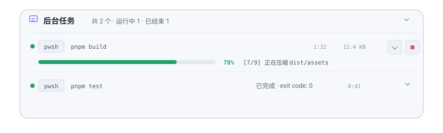
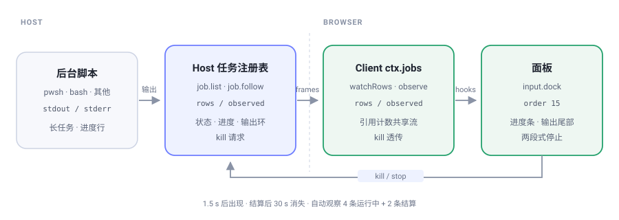

<p align="center">
  
</p>

<h1 align="center">dsh-jobs-progress</h1>

<p align="center">
  Let <b>DeepSeek Harness</b> background jobs explain what they are doing, right above the composer<br>
  automatic observation · percentage / fraction progress · output tail · two-press stop · <b>zero dependencies, no build</b>
</p>

<p align="center">
  <a href="https://github.com/hchao3335-maker/dsh-jobs-progress/actions/workflows/ci.yml"></a>
  <a href="LICENSE"></a>
  
  
  
  <a href="https://github.com/hchao3335-maker/dsh-jobs-progress/stargazers"></a>
  <a href="https://github.com/hchao3335-maker/dsh-jobs-progress/commits/main"></a>
</p>

<p align="center"><a href="README.md">中文</a> · English</p>

<p align="center">
  <a href="#why"> Why</a> ·
  <a href="#features"> Features</a> ·
  <a href="#panel"> Panel</a> ·
  <a href="#arch"> Architecture</a> ·
  <a href="#install"> Install</a> ·
  <a href="#usage"> Usage</a> ·
  <a href="#compat"> Compatibility</a> ·
  <a href="#verification"> Verification</a> ·
  <a href="#dev"> Development</a> ·
  <a href="#contributing"> Contributing</a> ·
  <a href="#license"> License</a>
</p>

> **TL;DR**: DSH's built-in job list is good at "inspect and manage history"; this plugin answers "what is the running script doing right now?" at a glance.
>
> The panel lives in `conversation.input.dock` and only reads the built-in client `ctx.jobs` service. It adds no Host routes, never writes `document.body`, and needs no build step.

---

<a id="why"></a>
##  Why

DSH already has background jobs, but the progress story is broken:

- The built-in list hides behind a **14 px icon** in the session header.
- `pwsh` / `bash` jobs have no `progress` field, so a row only shows a label, elapsed time, and a terminal code.
- Live output is only subscribed **after a row is expanded**.

The common result: a spinner with no idea what it is doing or how far it has gone.

| | Built-in list | dsh-jobs-progress |
| --- | --- | --- |
| Entry point | Small header icon | Persistent card above the composer |
| Output subscription | Only after expanding a row | Automatic for running jobs |
| Progress | Label / elapsed / terminal code | Percentage or fraction bar + output tail |
| Stop | Open the list first | Two-press stop in the row |
| History | Retains settled records | 30-second grace; history stays in the built-in list |

---

<a id="features"></a>
##  Features

| | Capability | Details |
| :--: | --- | --- |
|  | **Persistent panel** | Full-width above the composer; visible as soon as a job appears |
|  | **Automatic observation** | Running jobs are observed without expanding; up to 4 live + 2 recently settled |
|  | **Percentage / fraction parsing** | `job.progress` first, otherwise the last `78%`, `[7/9]`, or `3 of 10` in the latest 8 KiB; rejects `150%` and `2024/11` |
|  | **Output tail** | Expandable `<pre>`, 240 px max, inner scroll, auto-follows the bottom by default |
|  | **Elapsed time and bytes** | Updated every second, plus the latest non-empty output line |
|  | **Two-press stop** | First press arms "confirm", a second press within 3 s sends the kill; failures are visible |
|  | **Collapse memory** | Header folds; state persisted in `localStorage` |
|  | **Quiet by default** | Jobs younger than 1.5 s stay hidden; settled rows leave after 30 s |
|  | **Zero dependencies, no build** | Only `react` from the page module table; no Host routes, no Client package imports, no bundler |
|  | **Bilingual and accessible** | `role=progressbar`, `aria-valuenow`, labelled buttons, keyboard reachable, reduced-motion aware |

---

<a id="panel"></a>
##  Panel

<p align="center">
  
</p>

<p align="center"><sub>Illustration · the real look follows the active theme, window width, and output length</sub></p>

| Element | Behavior |
| --- | --- |
| **Status dot** | running / stopping / completed / killed / failed, with matching theme colors |
| **Kind badge** | `pwsh`, `bash`, or another producer kind |
| **Command first line** | Monospace, single-line ellipsis; hover for the full command |
| **Duration / bytes** | `mm:ss` or `h:mm:ss`, B / KB / MB, refreshed every second |
| **Progress zone** | Determinate bar, or indeterminate shimmer plus `streaming · N B`; latest output line below |
| **Expand** | Available when output exists; auto-follows until the reader scrolls up |
| **Stop** | Only on `running` rows; two-press confirmation, `stopping` shows "stopping" |

---

<a id="arch"></a>
##  Architecture

<p align="center">
  
</p>

- Data comes only from the built-in client `ctx.jobs` service: `watchRows` keeps the roster current, `observe` is a non-destructive output read, and `kill` is passed through.
- Both `watchRows` and `observe` are reference-counted; unmount, session switch, or a row leaving the visible set releases them and clears the output cache.
- The panel holds no transport state and does not reimplement the job list; settlement history stays in the built-in list.
- See [docs/architecture.md](docs/architecture.md) for the full flow and trade-offs.

---

<a id="install"></a>
##  Install

### Requirements

| Item | Requirement |
| --- | --- |
| DSH | `0.2.2-rc.5` or a compatible 0.2.x (uses the built-in `ctx.jobs` and `conversation.input.dock`) |
| Environment | Web client (Desktop or `dsh web`) |
| Dependencies | None; no `npm install`, no build |

### Step 1: get the code

```powershell
git clone https://github.com/hchao3335-maker/dsh-jobs-progress.git
```

### Step 2: install into the profile

Ask your DSH agent to install the directory:

```text
Use plugin_manager install_bundle with /path/to/dsh-jobs-progress
```

Or pack it first:

```powershell
npm pack
# then install the generated dsh-jobs-progress-1.0.0.tgz
```

> `private: true` is intentional: the plugin is not published to npm. Install it from the checkout or the tarball.

### Step 3: confirm activation

The install result should be `application: applied`. The client bundle usually hot-swaps through HMR; refresh the page if it does not appear immediately. There is no configuration, and the plugin applies to every session.

---

<a id="usage"></a>
##  Usage

### When a row appears

| Status | Condition |
| --- | --- |
| `running` / `stopping` | More than **1.5 s** after start |
| `completed` / `killed` / `failed` | Within **30 s** after settling, with output |

The 1.5 s grace filters the short-lived registry entries created by every foreground command. Longer foreground commands still appear because they are real jobs. When no row is visible, the panel renders nothing and releases all observation streams.

### How progress is parsed

1. The producer's `job.progress` line wins.
2. Otherwise scan the latest 8 KiB of output for the **last** valid figure.
3. Accept `78%`, `[7/9]`, `7/9`, or `3 of 10`.
4. Clamp percentages to `0..100`; require `b > 0` and `a <= b` for fractions.
5. Reject figures cut out of a longer number or a date (`150%`, `2024/11`).

### Controls

- **Stop**: first press arms a three-second confirmation; the second press sends the kill, then the row converges through the roster.
- **Expand**: rows with output expand to a scrolling `<pre>`; it follows the bottom until you scroll up.
- **Collapse**: click the header; the state is stored in `localStorage` under `dsh-background-monitor.collapsed`.
- **Keyboard**: every control is tabbable; the bar exposes `aria-valuenow` / `aria-busy`.

```powershell
# See it immediately: start a background job that prints progress
1..120 | ForEach-Object {
  "[{0}/120] {1}%  processing block {0}" -f $_, [math]::Round($_ / 120 * 100)
  Start-Sleep -Seconds 1
}
```

Run it with `run_in_background`, return to the session, and the panel appears above the composer.

---

<a id="compat"></a>
##  Compatibility

| Item | Value |
| --- | --- |
| **Tested DSH** | `@deepseek-ai/dsh` **0.2.2-rc.5** (Desktop, Windows) |
| **Runtime location** | Web client · `conversation.input.dock` (order 15) |
| **Data source** | Built-in client `ctx.jobs` (`watchRows` / `observe` / `kill`) |
| **Runtime dependencies** | 0 (React comes from the page module table) |
| **Build step** | None |
| **Install** | Profile bundle (local directory / tarball) |
| **Node** | ≥ 20 (development and CI only) |

---

<a id="verification"></a>
##  Verification

Version 1.0.0 was exercised on a real DSH `0.2.2-rc.5` Desktop instance:

| Scenario | Result |
| --- | --- |
| 240-second background job | Bar `RangeValue` moved from `39/100` to `42/100`; row `28% → 42%`, `1:07 → 1:42`, `1.8 KB → 3.2 KB` |
| Expand output | The `<pre>` received the full retained tail; the button switched to "collapse" |
| Two-press stop | "Confirm stop" → job `killed`; row showed `cancelled by the user` and the registry reported `killed` |
| Settled grace | A completed row stayed 30 s, then left; the panel disappeared when no rows were visible |
| Collapse persistence | Stayed collapsed across a session switch and component remount |
| CI | `npm run check`: syntax checks + **9 unit tests**, green in GitHub Actions |

> Verification used Windows UI Automation to read the real rendered tree and invoke the real buttons. There was no screenshot-level visual verification, and the English UI was not switched at runtime. Details and gaps: [docs/verification.md](docs/verification.md).

---

<a id="dev"></a>
##  Development

```powershell
npm run check    # node --check index.js client.js + node --test test/client.test.mjs
```

No runtime dependencies and no build step; `client.js` is a single-file client plugin that only takes `react` from the page module table.

```text
.
├── client.js                 # dock panel, parsing, stop state machine, styles
├── index.js                  # empty Host half
├── cordis.patch.yml          # bundle row
├── icon.svg                  # plugin-page icon
├── assets/                   # README logo / panel illustration / architecture / icons
├── locale/{zh,en}.json       # plugin-page metadata
├── test/client.test.mjs      # parser, formatter, dictionary, registration tests
├── docs/                     # architecture and verification notes
└── .github/workflows/ci.yml  # GitHub Actions
```

Rules of thumb:

- Keep the browser half single-file and buildless; do not import Harness Client packages such as `@deepseek-ai/dsh-client-ui-*` (they can crash the slot entry).
- Never write `document.body`, replace the app root, or build a floating overlay.
- Use theme tokens only, prefix classes with `dshbg-`, and render the scoped `<style>` inside the component.
- Add every visible string to both `zh` and `en`, and keep the key-parity test green.

---

<a id="limits"></a>
##  Scope and limitations

- **No shell `Write-Progress` parsing**: it is not on stdout; only text output is parsed.
- **Not a replacement for the built-in list**: history, clearing, and cross-session views stay there; this panel only covers a 30-second grace.
- **Foreground commands appear too**: every foreground command is registered as a job; those longer than 1.5 s show up, shorter ones are filtered. That is registry behavior, not a bug.
- **No notifications, sound, floating window, or history search**: intentionally out of scope for v1.
- **Limited visual verification**: no screenshot-level check, and neither a 340 px window nor the English UI was exercised at runtime.

---

<a id="contributing"></a>
##  Contributing

Issues and pull requests are welcome:

1. Open an issue first for larger changes so the direction stays aligned.
2. Run `npm run check` before submitting; syntax checks and all 9 unit tests must pass.
3. If you change parsing, add boundary cases to `test/client.test.mjs` (especially false positives).
4. Use `feat:`, `fix:`, `docs:` prefixes in commit messages.

A Star is the best support if this plugin helps you.

---

<a id="license"></a>
##  License

[MIT](LICENSE) © 2026 xianyiliang

<p align="center">
  <a href="https://star-history.com/#hchao3335-maker/dsh-jobs-progress&amp;Date">
    
  </a>
</p>
