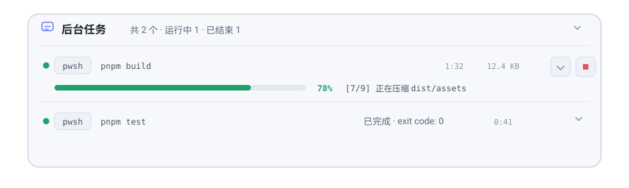
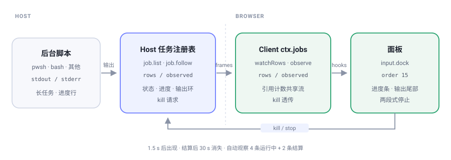

<p align="center">
  
</p>

<h1 align="center">dsh-jobs-progress</h1>

<p align="center">
  让 <b>DeepSeek Harness</b> 的后台任务在输入框上方说出自己在做什么<br>
  自动观察输出 · 百分比/分数进度 · 输出尾部 · 两段式停止 · <b>零依赖、无构建</b>
</p>

<p align="center">
  <a href="https://github.com/hchao3335-maker/dsh-jobs-progress/actions/workflows/ci.yml"></a>
  <a href="LICENSE"></a>
  
  
  
  <a href="https://github.com/hchao3335-maker/dsh-jobs-progress/stargazers"></a>
  <a href="https://github.com/hchao3335-maker/dsh-jobs-progress/commits/main"></a>
</p>

<p align="center">中文 · <a href="README.en.md">English</a></p>

<p align="center">
  <a href="#why"> 为什么</a> ·
  <a href="#features"> 特性</a> ·
  <a href="#panel"> 面板</a> ·
  <a href="#arch"> 架构</a> ·
  <a href="#install"> 安装</a> ·
  <a href="#usage"> 使用</a> ·
  <a href="#compat"> 兼容性</a> ·
  <a href="#verification"> 验证</a> ·
  <a href="#dev"> 开发</a> ·
  <a href="#contributing"> 贡献</a> ·
  <a href="#license"> 许可证</a>
</p>

> **一句话**：DSH 内置的任务列表适合「查看和管理历史」，这个插件负责「抬头就能看见正在跑的脚本到哪了」。
>
> 面板注册在 `conversation.input.dock`，只读取内置 `ctx.jobs` 客户端服务：**不新增 Host 路由、不写 `document.body`、不需要构建步骤**。关闭插件后所有行为立即消失。

---

<a id="why"></a>
##  为什么

DSH 已经有后台任务，但「看见进度」这件事是断的：

- 内置列表的入口是会话标题栏里一个 **14 px 的小图标**，不悬停/点击根本不知道它存在；
- `pwsh` / `bash` 任务默认没有 `progress` 字段，行里只有标签、已运行时长和终态码；
- 实时输出必须**手动展开某一行**才开始订阅。

于是最常见的情况是：上面在转圈，但不知道在干什么、跑到哪了。

| | 内置任务列表 | dsh-jobs-progress |
| --- | --- | --- |
| 入口 | 标题栏小图标 | 输入框上方常驻面板 |
| 输出订阅 | 展开某行才开始 | 运行中自动订阅 |
| 进度 | 只有标签 / 时长 / 终态码 | 百分比或分数进度条 + 输出尾部 |
| 停止 | 先打开列表再操作 | 行内两段式停止 |
| 历史 | 保留结算记录 | 30 秒 grace，历史仍交给内置列表 |

---

<a id="features"></a>
##  特性

| | 能力 | 说明 |
| :--: | --- | --- |
|  | **常驻面板** | 输入框上方整行显示，任务一出现就能看到，不用点标题栏图标 |
|  | **自动观察** | 运行中任务无需展开即订阅输出；最多同时观察 4 个运行中 + 2 个刚结算任务 |
|  | **百分比 / 分数解析** | 优先 `job.progress`，否则从输出尾部 8 KiB 取最后一个 `78%`、`[7/9]` 或 `3 of 10`；拒绝 `150%`、`2024/11` 这类假进度 |
|  | **输出尾部** | 展开 `<pre>` 看最近输出，最多 240 px 高、内部滚动，默认自动跟随到底部 |
|  | **耗时与字节** | 每秒刷新已运行时长、累计输出字节、最近一行非空输出 |
|  | **两段式停止** | 第一次点击变「确认停止」，3 秒内再点才真正 `kill`；失败有可见反馈 |
|  | **折叠记忆** | header 可折叠，状态写入 `localStorage`，刷新后保持 |
|  | **安静不闪烁** | 运行不足 1.5 秒的前台命令不出现；结算行 30 秒后自动消失 |
|  | **零依赖、无构建** | 只从页面模块表取 `react`；没有 Host 路由、没有 Client 包 import、没有构建步骤 |
|  | **中英双语 + 可访问性** | `role=progressbar`、`aria-valuenow`、按钮 `aria-label`、键盘可达、`prefers-reduced-motion` 友好 |

---

<a id="panel"></a>
##  面板

<p align="center">
  
</p>

<p align="center"><sub>面板示意 · 实际外观随主题、窗口宽度与输出长度变化</sub></p>

| 元素 | 行为 |
| --- | --- |
| **状态点** | 运行中 / 正在停止 / 已完成 / 已取消 / 已失败，各有对应主题色 |
| **kind 徽标** | 显示 `pwsh`、`bash` 或其它产物类型 |
| **命令首行** | mono 字体、单行省略；悬停显示完整命令 |
| **时长 / 字节** | 每秒刷新；`mm:ss` 或 `h:mm:ss`，B / KB / MB |
| **进度区** | 确定百分比进度条，或不定 shimmer +「输出中 · N B」；下方是最近一行输出 |
| **展开** | 有输出即可展开；`<pre>` 自动跟随，用户手动上滚后不再强拉 |
| **停止** | 仅 `running` 行可用；两段确认，`stopping` 时显示「正在停止」 |

---

<a id="arch"></a>
##  架构

<p align="center">
  
</p>

- 数据只走内置客户端服务 `ctx.jobs`：`watchRows` 保持 roster 最新，`observe` 非消费式读取输出，`kill` 透传停止请求。
- `watchRows` / `observe` 都是引用计数：面板卸载、会话切换或行离开可见集时调用返回的释放函数，输出缓存随之清空。
- 面板不持有传输状态，也不重复实现任务列表；结算历史仍由内置列表承担。
- 更完整的数据流与取舍见 [docs/architecture.md](docs/architecture.md)。

---

<a id="install"></a>
##  安装

### 前置

| 项 | 要求 |
| --- | --- |
| DSH | `0.2.2-rc.5` 或兼容的 0.2.x（使用内置 `ctx.jobs` 与 `conversation.input.dock`） |
| 环境 | Web Client（桌面版 / `dsh web` 均可） |
| 依赖 | 无；不需要 `npm install`，不需要构建 |

### 第 1 步：获取代码

```powershell
git clone https://github.com/hchao3335-maker/dsh-jobs-progress.git
```

### 第 2 步：装进 profile

在 DSH 会话里让 agent 使用插件管理器安装本目录：

```text
用 plugin_manager install_bundle 安装 C:\path\to\dsh-jobs-progress
```

或者先打包再安装：

```powershell
npm pack
# 然后安装生成的 dsh-jobs-progress-1.0.0.tgz
```

> `private: true` 是有意的：插件未发布到 npm，请从仓库目录或 tarball 安装。

### 第 3 步：确认生效

安装结果应为 `application: applied`。客户端 bundle 通常经 HMR 热换；如果没有立即出现，刷新页面即可。插件没有配置项，启用后对所有会话生效。

安装后可以检查 slot：

```text
conversation.input.dock → background-jobs-monitor（order 15，active）
```

---

<a id="usage"></a>
##  使用

### 什么时候出现

| 任务状态 | 出现条件 |
| --- | --- |
| `running` / `stopping` | 启动已超过 **1.5 秒** |
| `completed` / `killed` / `failed` | 结算后 **30 秒**内，且确有输出 |

1.5 秒的宽限用于过滤每条前台命令短暂注册的 job；运行较久的前台命令仍会正常出现，因为它确实是注册表里的任务。面板无行时整体不渲染，并释放所有观察流。

### 进度怎么解析

1. 优先使用任务自身的 `job.progress` 行；
2. 否则扫描输出尾部 8 KiB，取**最后一个**合法数字；
3. 支持 `78%`、`[7/9]`、`7/9`、`3 of 10`；
4. 百分比限制在 `0..100`，分数要求 `b > 0` 且 `a <= b`；
5. 拒绝从更长数字或日期中截出的假进度（`150%`、`2024/11`）。

### 操作

- **停止**：第一次点击进入「确认停止」，3 秒内再点才请求停止；超时自动解除。
- **展开**：有输出的行可展开，输出自动跟随到底部；手动上滚后停止跟随。
- **折叠**：点 header 折叠/展开，状态写入 `localStorage`（`dsh-background-monitor.collapsed`）。
- **键盘**：所有按钮可 Tab 聚焦；进度条带 `aria-valuenow` / `aria-busy`。

```powershell
# 想马上看到效果：启动一个会打进度行的后台任务
1..120 | ForEach-Object {
  "[{0}/120] {1}%  正在处理块 {0}" -f $_, [math]::Round($_ / 120 * 100)
  Start-Sleep -Seconds 1
}
```

用 DSH 的 `run_in_background` 运行上面的脚本，回到会话，输入框上方就会出现面板。

---

<a id="compat"></a>
##  兼容性

| 项 | 值 |
| --- | --- |
| **实测版本** | `@deepseek-ai/dsh` **0.2.2-rc.5**（Desktop，Windows） |
| **运行位置** | Web Client · `conversation.input.dock`（order 15） |
| **数据来源** | 内置 `ctx.jobs` 客户端服务（`watchRows` / `observe` / `kill`） |
| **运行时依赖** | 0（React 来自页面模块表） |
| **构建步骤** | 无 |
| **安装方式** | profile bundle（本地目录 / tarball） |
| **Node** | ≥ 20（仅开发与 CI 需要） |

---

<a id="verification"></a>
##  验证

1.0.0 在 DSH `0.2.2-rc.5` Desktop 上做过真实运行验证（不是模拟页面）：

| 场景 | 结果 |
| --- | --- |
| 240 秒后台任务 | 进度条 `RangeValue` 从 `39/100` 到 `42/100`；行内 `28% → 42%`，时长 `1:07 → 1:42`，字节 `1.8 KB → 3.2 KB` |
| 展开输出 | `<pre>` 拿到完整保留尾部，按钮切换为「收起」 |
| 两段式停止 | 「确认停止」→ 任务 `killed`，行显示 `已取消 · cancelled by the user` |
| 结算 grace | 已完成行 30 秒后消失，面板无行时整体不渲染 |
| 折叠持久化 | 切换会话重挂载后仍保持折叠 |
| CI | `npm run check`：语法检查 + **9 项单元测试**，GitHub Actions 绿色 |

> 验证通过 Windows UI Automation 读取真实渲染树并触发真实按钮；本轮没有截图级视觉验证，也没有在运行时切换英文界面。细节与未验证项见 [docs/verification.md](docs/verification.md)。

---

<a id="dev"></a>
##  开发

```powershell
npm run check    # node --check index.js client.js + node --test test/client.test.mjs
```

没有运行时依赖，没有构建步骤；`client.js` 是单文件客户端插件，只从页面模块表取 `react`。

```text
.
├── client.js                 # dock 面板、进度解析、停止状态机、样式
├── index.js                  # Host 半边（空）
├── cordis.patch.yml          # bundle 行
├── icon.svg                  # 插件页图标
├── assets/                   # README 用 logo / 面板示意 / 架构图 / 图标
├── locale/{zh,en}.json       # 插件页元数据
├── test/client.test.mjs      # 解析 / 格式化 / 字典 / 注册测试
├── docs/                     # 架构与验证记录
└── .github/workflows/ci.yml  # GitHub Actions
```

改动约定：

- 保持单文件、无构建；不要 import Harness Client 包（`@deepseek-ai/dsh-client-ui-*`），否则槽位可能白屏。
- 不写 `document.body`、不替换 app root、不做浮层。
- 样式只用主题 token，前缀 `dshbg-`；组件内 `<style>` 随卸载移除。
- 新增可见文案时同时补 `zh` / `en`，并让 `test/client.test.mjs` 的 key 对齐测试通过。

---

<a id="limits"></a>
##  已知限制

- **不解析 shell 的 `Write-Progress`**：它不在 stdout 里，只解析文本输出。
- **不替代内置任务列表**：历史任务、清空、跨会话查看仍在标题栏列表；这里只做 30 秒 grace。
- **前台命令也会出现**：注册表把每条前台命令都登记为 job；超过 1.5 秒会显示，短命令被过滤。这是注册表行为，不是 bug。
- **没有通知/声音/悬浮窗/历史搜索**：按 v1 范围刻意不做。
- **视觉验证有限**：没有截图级验证，窄窗口（340 px）和英文界面未在运行时实测。

---

<a id="contributing"></a>
##  贡献

欢迎 issue 和 PR。建议：

1. 较大的改动先开 issue 说清楚场景，避免方向不一致；
2. 提交前跑 `npm run check`，确保语法检查和 9 项单元测试通过；
3. 如果改了进度解析规则，补 `test/client.test.mjs` 的边界用例（尤其是假进度）；
4. commit message 使用 `feat:` / `fix:` / `docs:` 等前缀。

如果这个插件对你有帮助，点个 Star 就是最好的支持。

---

<a id="license"></a>
##  许可证

[MIT](LICENSE) © 2026 xianyiliang

<p align="center">
  <a href="https://star-history.com/#hchao3335-maker/dsh-jobs-progress&amp;Date">
    
  </a>
</p>
