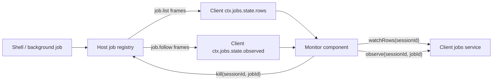

# Architecture

## Data flow

The plugin is a pure browser-side view over the built-in jobs service. The Host
half is an empty `apply()`: it exists only so the bundle patch has a row to
activate, which is also what loads `dsh.client`.

## Why a dock, not a popover

The built-in job list already lives in the session header and is the right place
for history. The missing affordance is *ambient* progress, so the panel sits in
`conversation.input.dock`, the full-width band above the composer. Its `order`
is **15**, between the goal dock (10) and the queue dock (20).

`QueueDock` deliberately cancels the composer stack gap and tucks 3 px under the
input card with a negative bottom margin. Putting another panel after it breaks
that attached seam, so this panel registers above it. When the queue is empty
the visible position is the same as any other order above the composer.

## Visibility windows

| State | Condition to show a row |
| --- | --- |
| `running` / `stopping` | `now - startedAt >= 1500 ms` |
| `completed` / `killed` / `failed` | `now - finishedAt <= 30000 ms` and `output.total > 0` |

The 1.5 s lower bound suppresses the short-lived registry entries that every
foreground `pwsh` / `bash` command creates. Long foreground commands still
appear by design; they are real jobs in the same registry. The 30 s upper bound
keeps settlement history in the built-in list instead of this panel.

The clock is armed only while a row can still change: a live job (including one
still inside its grace period) or a settled row inside its grace period. Old
settlement records remain in the roster, so gating on `rows.length` would tick
forever after every row expired.

## Observation budget

At most four live rows and two recently settled rows are observed at a time.
Expanding a visible row adds that job to the observed set even when the budget
is exhausted, so a human can always open a specific job. When a row leaves the
visible set, its expanded state is cleared, which releases the observation
stream and the retained output view.

`observe()` is reference-counted and non-destructive: the plugin never advances
the model's `job_output` cursor. `watchRows()` is released on session change or
unmount.

## Progress parsing

1. If the producer set `job.progress`, parse that line first.
2. Otherwise scan the last 8 KiB of the observed output.
3. Accept the **last** valid figure: `n%`, `[a/b]`, `a/b`, or `a of b`, with
   `0 <= percent <= 100` and `b > 0`, `a <= b`.
4. Reject matches that start inside a longer number or a date, e.g. `150%` or
   `2024/11`.
5. No figure means an indeterminate bar plus `输出中 · N B`.

## Stop state machine

`idle -> armed -> pending -> (row settles)`. The armed state expires after three
seconds and the button shows visible "confirm" copy while armed. A rejected
request enters `failed` for four seconds and shows "stop failed" in the button.
Row state itself converges through the jobs roster; the plugin never assumes the
kill succeeded from the RPC response alone.

## Styling and i18n

- One scoped `<style>` element with the `dshbg-` prefix, removed with the
  component.
- Theme tokens only: menu surface, elevation, radius, label/border/state colors,
  composer dock sizes, and code font.
- Only `react` is required from the page module table; no Harness Client package
  imports, so a missing primitive cannot crash the slot entry.
- Dictionaries are registered under the `background-monitor` namespace; plugin
  page metadata lives in `locale/zh.json` and `locale/en.json`.
